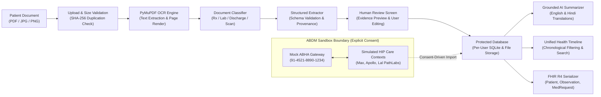

# Health Copilot — AI-Powered Personal Health Platform

> **Altrix Labs Healthcare Hackathon Submission**  
> **Core Promise:** Understand your reports. Organize your history. Make informed conversations with your doctor.

Health Copilot converts fragmented medical documents—prescriptions, laboratory reports, diagnostic imaging, and hospital discharge summaries—into understandable, organized, and traceable health information.

---

## 1. Visual Identity & Design Direction

Following the clinical design aesthetics of modern healthcare platforms (HealthPlus reference):
- **Primary Color:** Deep clinical red (`#D71920`) for active states, vital signs, ECG lines, and key CTAs.
- **Secondary Accent:** Near-black (`#111111`) for typography and high-contrast clinical readability.
- **Backgrounds:** Clean white (`#FFFFFF`) with subtle neutral grey surfaces (`#F8F9FA`) and soft blush accents (`#FEF2F2`).
- **Brand Elements:** Clean Heart-and-ECG emblem, animated heartbeat line dividers, and authentic clinical imagery.
- **Icons:** Lucide icons throughout.

---

## 2. System Architecture



---

## 3. Key Functional Modules

| Module | Implementation Details |
|---|---|
| **Document Ingestion & OCR** | PyMuPDF text parsing for digital PDFs; high-resolution PNG rendering for side-by-side evidence inspection; English and Hindi language detection; handwritten/low-confidence flags. |
| **Structured Extraction** | Schema-validated field mapping with exact source snippets, page numbers, and confidence scores for Prescriptions, Labs, Discharge Summaries, and Diagnostics. |
| **Human Review & Correction** | Side-by-side comparison between the original document preview and editable fields; preserves raw extraction for auditability; commits verified records. |
| **AI Health Summaries** | Plain-language interpretations explaining laboratory ranges without independent diagnosing; compatible historical trend comparisons; curated doctor questions; English & Hindi. |
| **Unified Health Timeline** | Chronological record stream with category tabs, search bar, status badges, and 1-click links to source documents, extracted data, and plain summaries. |
| **Medication Management** | Categorizes documented medicines into *Current*, *Historical* (e.g. completed antibiotic courses), and *Unknown*; prepared questions for doctor visits. |
| **ABHA Sandbox Readiness** | Simulated ABHA connection (`91-4521-8890-1234`), explicit consent management, discoverable care contexts from simulated HIPs, and 1-click import into timeline. |
| **FHIR R4 Interoperability** | Native resource serialization for `Patient`, `Observation`, `MedicationRequest`, `Condition`, `DocumentReference`, and `Bundle`. |
| **Privacy, Consent & Audit** | User data isolation, password hashing with bcrypt, live tamper-evident audit trail, and document erasure workflow. |
| **Accuracy & Benchmark** | Automated evaluation dashboard measuring field-level extraction accuracy and 100% groundedness on synthetic test suites. |

---

## 4. Quick Start & Setup

### Prerequisites
- **Python:** 3.10+ (tested on Python 3.14)
- **Node.js:** 18+ (tested on Node v24.18)
- **npm:** 9+

### 1. Backend Setup
```bash
cd backend

# Install dependencies
python -m pip install -r requirements.txt

# Start FastAPI server (Runs on http://127.0.0.1:8000)
python -m uvicorn app.main:app --host 127.0.0.1 --port 8000
```
*API documentation and interactive Swagger UI are available at `http://127.0.0.1:8000/docs`.*

### 2. Frontend Setup
```bash
cd frontend

# Install npm dependencies
npm install

# Start Vite dev server (Runs on http://127.0.0.1:5173)
npm run dev
```

---

## 5. Instant Demo Mode (Hackathon Evaluation)

You do **not** need to create an account or provide real medical records to evaluate the platform:
1. Open `http://localhost:5173/` in your browser.
2. Click the **"1-Click Demo"** button in the header or hero section.
3. You will be instantly logged in as synthetic demo patient **Aarav Sharma** (42 Y / Male, UHID: `APX-98214`).
4. Pre-seeded demo records include:
   - **Recent Lab Report (12-Mar-2026):** HbA1c 7.4% (High), Fasting Sugar 138 mg/dL (High), Total Cholesterol 218 mg/dL (High).
   - **Historical Lab Report (15-Oct-2025):** Baseline HbA1c 6.8% for trend evaluation.
   - **Clinical Prescription (10-Mar-2026):** Dr. Vikram Seth (Metformin 500mg BD, Atorvastatin 10mg OD, Telmisartan 40mg OD).
   - **Discharge Summary (18-Jan-2026):** Fortis Hospital (Acute Gastroenteritis, completed Rifaximin course).
   - **ABHA Connection:** Mock ID `91-4521-8890-1234` with simulated care contexts.

### Test Documents Included
Ready-to-use sample PDFs are generated in the project root:
- `test_samples/sample_prescription.pdf`
- `test_samples/sample_lab_report.pdf`
- `test_samples/sample_discharge_summary.pdf`

You can also use the **"Quick Demo: Load Sample Document"** buttons on the Upload page.

---

## 6. Environment Variables

Create `.env` in `backend/` if configuring optional external LLM providers:

```env
APP_NAME="Health Copilot"
SECRET_KEY="health-copilot-secure-dev-jwt-key-2026-altrix"
LLM_PROVIDER="deterministic_grounded" # 'deterministic_grounded', 'gemini', or 'openai'

# Optional LLM API Keys (Falls back automatically to high-fidelity deterministic grounded interpretation if blank)
GEMINI_API_KEY=""
OPENAI_API_KEY=""

# ABHA Sandbox URL
ABHA_SANDBOX_URL="https://sandbox.abdm.gov.in/v1"
```

---

## 7. Clinical Safety & Non-Diagnostic Guardrails

- **No Medical Diagnoses:** Health Copilot explains what lab values measure and flags deviations from printed laboratory ranges. It never issues diagnostic conclusions.
- **No Independent Treatment Changes:** The application never advises starting, stopping, or altering medication doses.
- **Reference Range Grounding:** All abnormal flags are anchored exclusively to the reference intervals printed on that specific report.
- **Evidence Traceability:** 100% of claims made in AI summaries cite exact snippets and page numbers from source documents.
- **Persistent Medical Disclaimer:** Visibly displayed across all screens and reports.

---

## 8. Limitations & Future Production Requirements

### Current Prototype Scope
- The ABHA connection interacts with simulated Health Information Providers (HIPs) in an isolated sandbox.
- OCR utilizes PyMuPDF digital parsing and font rasterization; handwriting recognition flags low-confidence tokens for human verification.
- Local protected SQLite database and storage for demonstration.

### Requirements for Production Deployment
1. **ABDM Gateway Certification:** Formal M1, M2, and M3 milestone certification with the National Health Authority (NHA).
2. **Regulatory Audits:** Independent third-party HIPAA, ISO 27001, and DISHA compliance audits.
3. **Enterprise Storage:** Transition from local filesystem storage to client-side encrypted S3/GCS buckets with HSM-managed keys.
4. **Production Database:** Migration to managed PostgreSQL with row-level security (RLS).
5. **Multi-Factor Authentication (MFA):** Aadhaar OTP or biometric authentication for ABHA health ID linking.

---

## 9. Deliverables Directory

- `demo_script.md`: Step-by-step hackathon demo presentation outline.
- `testing_checklist.md`: Comprehensive testing and clinical safety verification checklist.
- `test_samples/`: Synthetic medical documents ready for drag-and-drop testing.
- `backend/`: FastAPI application, PyMuPDF engine, schemas, SQLite database.
- `frontend/`: React 19, TypeScript, Tailwind CSS, Lucide icons, bilingual dictionaries.
